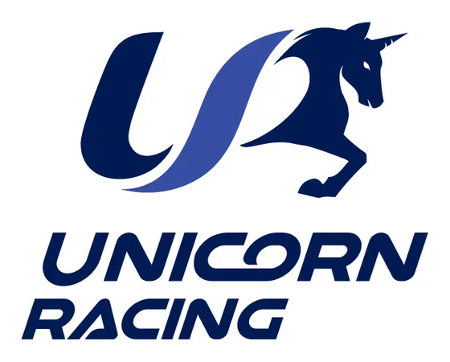

  <picture>
    <source media="(prefers-color-scheme: dark)" srcset="./assets/logo-dark.png">
    
  </picture>

<h3 align="center">Autonomous racing team · HMCLab, UNIST, South Korea</h3>

  <a href="https://hmcl-unist.github.io/unicorn-racing/"><b>Blog</b></a>
  &nbsp;·&nbsp;
  <a href="https://hmcl-unist.github.io/"><b>HMCLab</b></a>

We build and race 1:10-scale autonomous cars (RoboRacer). This organization hosts the team's racing stack and simulation work. Race reports, results and technical notes are on the blog.
